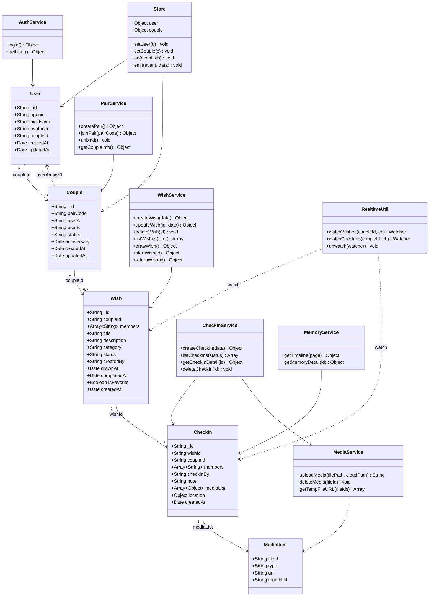
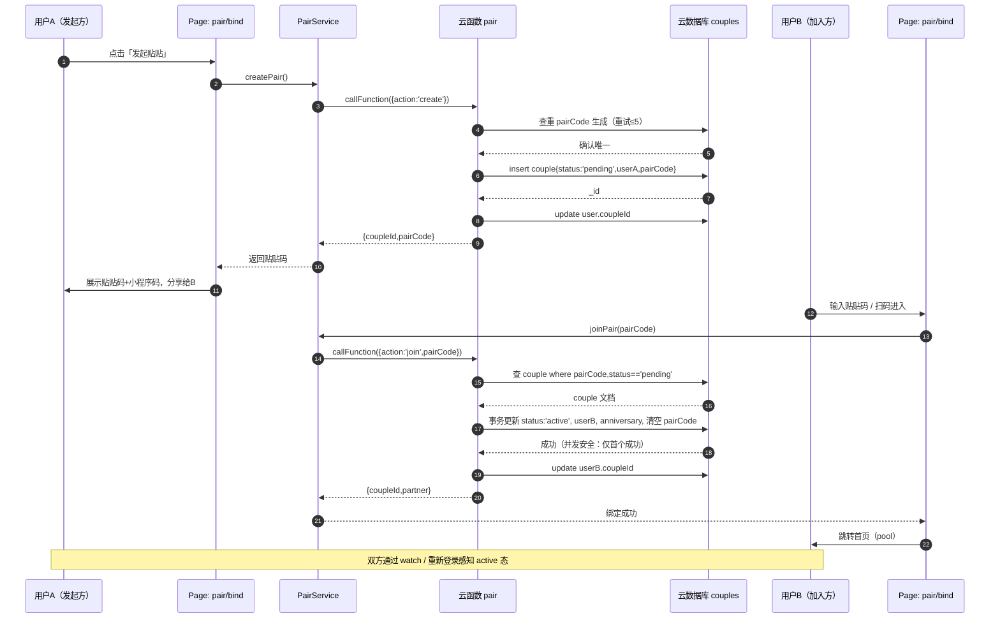
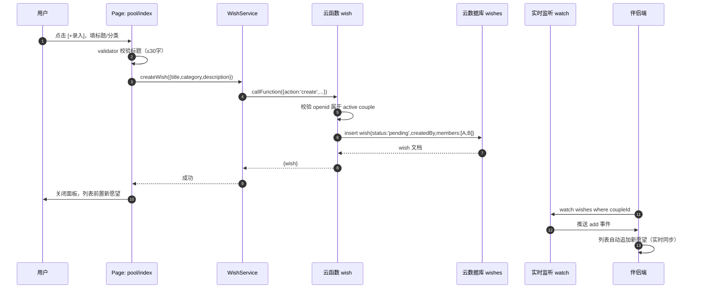
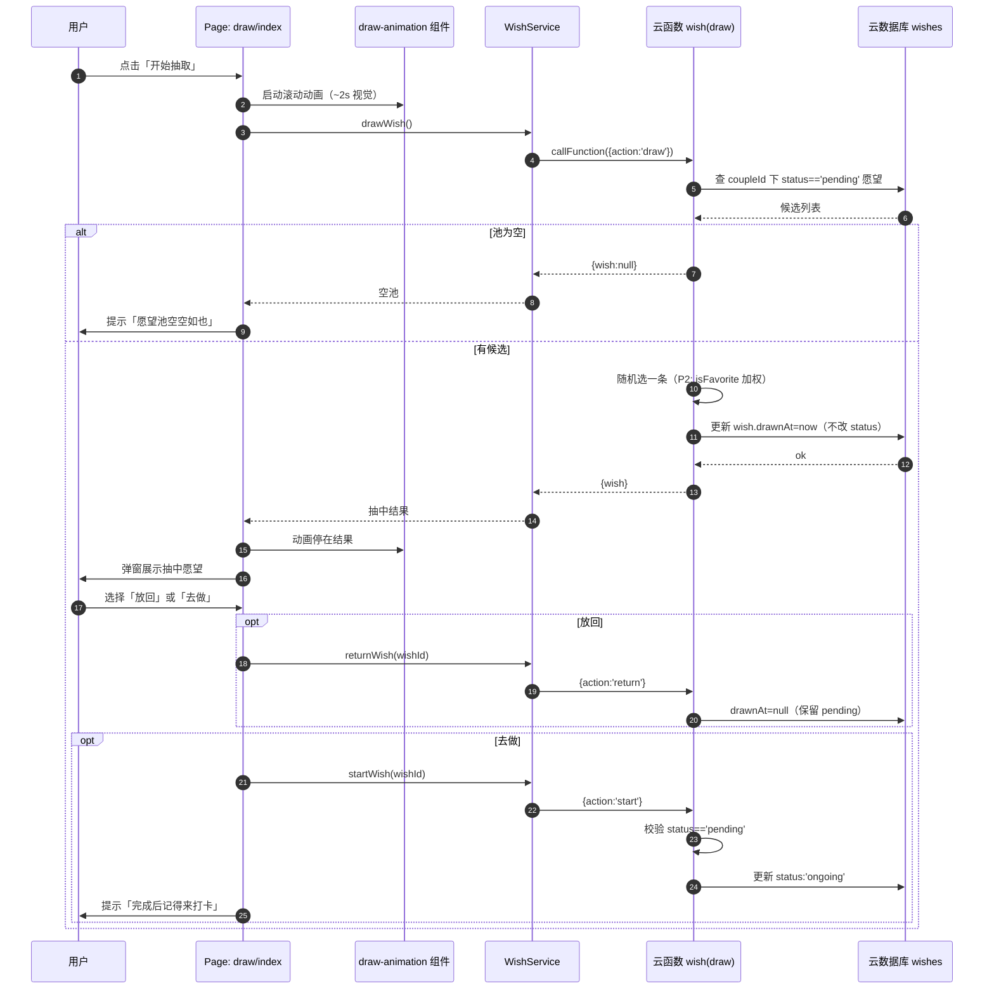
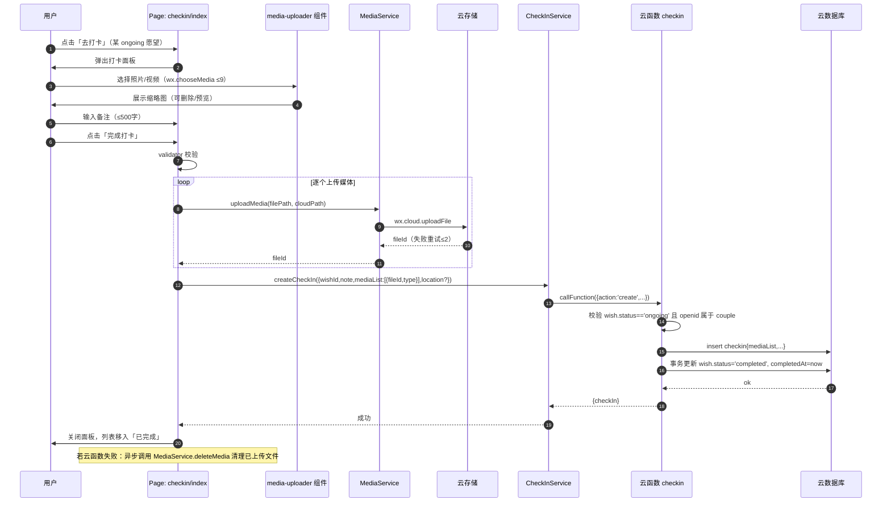
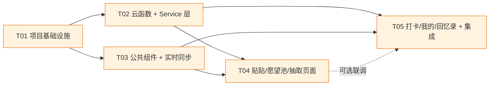

# 架构设计文档 · 心愿拾光（情侣愿望池小程序）

> **文档版本**：v1.0
> **撰写人**：架构师 高见远（Gao）
> **日期**：2026-07-22
> **基于**：PRD v1.0（产品经理 许清楚）
> **状态**：已完成，待评审

---

## 目录

- [Part A：系统设计](#part-a系统设计)
  - [1. 实现方案与框架选型](#1-实现方案与框架选型)
  - [2. 文件列表与相对路径](#2-文件列表与相对路径)
  - [3. 数据结构与接口（类图）](#3-数据结构与接口类图)
  - [4. 程序调用流程（时序图）](#4-程序调用流程时序图)
  - [5. 待明确事项](#5-待明确事项)
- [Part B：任务分解](#part-b任务分解)
  - [6. 依赖包列表](#6-依赖包列表)
  - [7. 任务列表（按依赖顺序）](#7-任务列表按依赖顺序)
  - [8. 共享知识（跨文件约定）](#8-共享知识跨文件约定)
  - [9. 任务依赖图](#9-任务依赖图)

---

# Part A：系统设计

## 1. 实现方案与框架选型

### 1.1 技术栈确认

| 层级 | 技术选型 | 说明 |
|------|----------|------|
| 前端框架 | 小程序原生框架（WXML/WXSS/JS） | PRD 指定，无需跨端，原生性能与兼容性最佳 |
| UI 组件库 | WeUI for 小程序 | PRD 指定，提供基础组件（cell/button/dialog/toast 等） |
| 状态管理 | 轻量自研 Store（globalData + 事件总线） | 情侣场景状态简单，无需引入 mobx-miniprogram 增加复杂度 |
| 后端 | 微信云开发 CloudBase | PRD 指定，免运维，天然鉴权 openid |
| 云函数 | Node.js（云函数运行时） | 业务逻辑、原子操作、聚合查询 |
| 数据库 | 云数据库（NoSQL，类 MongoDB） | 文档型存储，契合情侣/愿望/打卡结构 |
| 存储 | 云存储 | 照片/视频文件存储，返回 fileID |
| 实时同步 | 云数据库 `watch()` 实时推送 | 实现情侣双方数据实时同步 |

### 1.2 核心技术挑战与对策

| # | 挑战 | 对策 |
|---|------|------|
| C1 | **情侣数据实时同步**：一方操作，另一方需即时可见 | 使用 `db.collection().watch()` 监听 `coupleId` 维度数据变更；页面 onLoad 注册监听、onUnload 注销 |
| C2 | **贴贴并发安全**：同一贴贴码被多人同时输入加入，需保证只有第一人成功 | 云函数 `pair(join)` 使用事务 + `status` 字段乐观锁：仅当 `status==='pending'` 时才更新为 `active` 并写入 userB，避免重复绑定 |
| C3 | **随机抽取公平性 + 收藏权重（P2）** | 云函数 `wish(draw)` 在服务端聚合 `coupleId` 下 `status==='pending'` 的愿望；P2 阶段对 `isFavorite===true` 项复制权重倍数后再随机，保证服务端权威、客户端不可作弊 |
| C4 | **愿望状态机完整性**：pending→ongoing→completed 单向流转，禁止跳态/回退 | 所有状态变更必须经云函数，云函数校验当前状态合法性后才写入；客户端只读状态 |
| C5 | **媒体上传可靠性**：照片/视频上传可能失败中断 | 客户端 `wx.cloud.uploadFile` 串行/并行上传，单文件失败重试 2 次；全部成功后再调 `checkin(create)` 写记录；若写记录失败则异步清理已上传文件 |
| C6 | **数据权限隔离**：愿望/打卡仅情侣双方可见 | 共享集合（wishes/checkins）冗余 `members:[openidA,openidB]` 字段，数据库安全规则 `read: auth.openid in doc.members`，写操作仅经云函数（客户端 `write:false`） |
| C7 | **贴贴码唯一性**：6 位码碰撞 | 云函数生成时查重 + 冲突重生成（最多 5 次）；`pairCode` 字段建唯一索引（sparse，仅 pending 态有值） |
| C8 | **首次进入引导**：未贴贴用户强制跳转绑定页 | `app.js` 登录后判断 `couple.status`，未贴贴则重定向 `pages/pair/bind`，TabBar 页面 onLoad 二次校验 |

### 1.3 架构模式

采用 **分层 Page-MVC 变体**：

```
┌─────────────────────────────────────────────┐
│  View 层  Pages（页面 WXML/WXSS/JS）          │  负责渲染与交互
│    └── Components（复用组件）                  │
├─────────────────────────────────────────────┤
│  Service 层  services/*.js                    │  封装云函数调用 + 本地缓存
├─────────────────────────────────────────────┤
│  Cloud 层  cloudfunctions/*                   │  业务逻辑、原子操作、鉴权
├─────────────────────────────────────────────┤
│  Data 层  云数据库集合 / 云存储                │  持久化
└─────────────────────────────────────────────┘
        ↕ 横切：utils（工具）、store（全局状态）、config（配置）
```

- **Page → Service**：页面只调用 service，不直接 `wx.cloud.callFunction`，便于统一错误处理与 loading。
- **Service → Cloud Function**：service 通过 `utils/request.js` 统一封装调用，处理 code 包装。
- **Cloud Function → DB/Storage**：云函数内完成鉴权（校验 openid 属于 couple）后操作数据。
- **实时同步**：Page 直接对 DB 建立 `watch()`（仅读权限），不走云函数，保证低延迟推送。

### 1.4 云开发资源规划

#### 云函数清单

| 函数名 | 职责 | 主要 action |
|--------|------|-------------|
| `login` | 登录注册、获取用户与贴贴状态 | — |
| `pair` | 情侣贴贴全生命周期 | `create` / `join` / `unbind` / `info` |
| `wish` | 愿望 CRUD + 抽取 + 状态流转 | `create` / `update` / `delete` / `list` / `draw` / `start` / `return` |
| `checkin` | 打卡记录管理 | `create` / `list` / `detail` / `delete` |
| `memory` | 回忆录时间线聚合 | `timeline` / `detail` |
| `stats` | 数据统计（P2） | `overview` |

#### 云数据库集合

| 集合 | 用途 | 安全规则要点 |
|------|------|--------------|
| `users` | 用户档案 | 仅本人 openid 可读写 |
| `couples` | 贴贴关系 | userA/userB 可读，仅云函数写 |
| `wishes` | 愿望 | `members` 内 openid 可读，仅云函数写 |
| `checkins` | 打卡记录 | `members` 内 openid 可读，仅云函数写 |

> Media 不单独建集合，作为 `checkins.mediaList` 内嵌数组存储（MVP 简化，满足 1-9 张需求；后续如需独立清理再拆分）。

#### 云存储目录

```
cloud://{envId}.xxx/
└── media/
    ├── images/{coupleId}/{checkInId}/{timestamp}_{index}.jpg
    └── videos/{coupleId}/{checkInId}/{timestamp}_{index}.mp4
```

按 `coupleId/checkInId` 分目录，便于解绑时批量清理某对情侣的全部媒体。

---

## 2. 文件列表与相对路径

> 根目录为小程序项目根。`miniprogram/` 为前端代码，`cloudfunctions/` 为云函数。

### 2.1 项目配置与入口

| 文件路径 | 说明 |
|----------|------|
| `project.config.json` | 项目配置（appid、cloudfunctionRoot、miniprogramRoot） |
| `project.private.config.json` | 本地私有配置 |
| `miniprogram/app.js` | 小程序入口（登录、全局状态初始化、贴贴态路由守卫） |
| `miniprogram/app.json` | 全局配置（pages、tabBar、window、cloud env） |
| `miniprogram/app.wxss` | 全局样式（主题色、通用类） |
| `miniprogram/sitemap.json` | 搜索收录配置 |
| `miniprogram/package.json` | 前端 npm 依赖声明 |

### 2.2 配置与工具

| 文件路径 | 说明 |
|----------|------|
| `miniprogram/config/index.js` | 环境配置（envId、云存储路径模板、分类枚举） |
| `miniprogram/utils/constants.js` | 常量枚举（category、wishStatus、coupleStatus） |
| `miniprogram/utils/request.js` | 云函数统一调用封装（loading/code 解包/错误处理） |
| `miniprogram/utils/store.js` | 全局状态管理（user、couple 缓存 + 事件总线） |
| `miniprogram/utils/format.js` | 格式化（日期、相对时间、文本截断） |
| `miniprogram/utils/validator.js` | 输入校验（愿望标题、打卡备注长度等） |
| `miniprogram/utils/realtime.js` | 实时监听封装（watch 注册/注销管理） |

### 2.3 Service 层

| 文件路径 | 说明 |
|----------|------|
| `miniprogram/services/api.js` | 各 service 汇总导出 |
| `miniprogram/services/auth.js` | 登录、用户信息 |
| `miniprogram/services/pair.js` | 贴贴 create/join/unbind/info |
| `miniprogram/services/wish.js` | 愿望 CRUD/draw/start/return |
| `miniprogram/services/checkin.js` | 打卡 create/list/detail |
| `miniprogram/services/media.js` | 媒体上传/删除（wx.cloud.uploadFile 封装） |
| `miniprogram/services/memory.js` | 回忆录 timeline/detail |

### 2.4 公共组件

| 组件路径 | 说明 |
|----------|------|
| `miniprogram/components/wish-card/` | 愿望卡片（分类图标、状态色、添加人、左滑操作） |
| `miniprogram/components/checkin-card/` | 打卡记录卡片（缩略图、备注、日期） |
| `miniprogram/components/draw-animation/` | 抽取滚动动画 |
| `miniprogram/components/media-uploader/` | 媒体选择+上传+预览+删除 |
| `miniprogram/components/category-tag/` | 分类标签（筛选/选择两种模式） |
| `miniprogram/components/empty-state/` | 空状态占位 |

（每个组件含 `.js/.json/.wxml/.wxss` 四件套）

### 2.5 页面

| 页面路径 | 类型 | 说明 |
|----------|------|------|
| `miniprogram/pages/pair/bind.*` | 子页面 | 贴贴绑定（发起/加入） |
| `miniprogram/pages/pool/index.*` | TabBar | 首页愿望池 |
| `miniprogram/pages/draw/index.*` | TabBar | 随机抽取 |
| `miniprogram/pages/checkin/index.*` | TabBar | 打卡记录列表 |
| `miniprogram/pages/profile/index.*` | TabBar | 我的 |
| `miniprogram/pages/wish/detail.*` | 子页面 | 愿望详情/编辑 |
| `miniprogram/pages/checkin/detail.*` | 子页面 | 打卡详情 |
| `miniprogram/pages/memory/index.*` | 子页面 | 回忆录时间线 |
| `miniprogram/pages/memory/detail.*` | 子页面 | 回忆录详情 |
| `miniprogram/pages/profile/settings.*` | 子页面 | 设置（解绑等） |

（每个页面含 `.js/.json/.wxml/.wxss` 四件套）

### 2.6 云函数

| 云函数路径 | 说明 |
|------------|------|
| `cloudfunctions/login/index.js` + `package.json` + `config.json` | 登录 |
| `cloudfunctions/pair/index.js` + `package.json` + `config.json` | 贴贴 |
| `cloudfunctions/wish/index.js` + `package.json` + `config.json` | 愿望 |
| `cloudfunctions/checkin/index.js` + `package.json` + `config.json` | 打卡 |
| `cloudfunctions/memory/index.js` + `package.json` + `config.json` | 回忆录 |
| `cloudfunctions/stats/index.js` + `package.json` + `config.json` | 统计（P2） |

---

## 3. 数据结构与接口（类图）

### 3.1 数据模型（云数据库文档）

#### users 集合

| 字段 | 类型 | 说明 | 索引 |
|------|------|------|------|
| `_id` | String | 主键 | — |
| `openid` | String | 微信 openid | 唯一索引 |
| `nickName` | String | 昵称 | — |
| `avatarUrl` | String | 头像 | — |
| `coupleId` | String | 贴贴关系 ID（未贴贴为 `''`） | 普通索引 |
| `createdAt` | Date | 注册时间 | — |
| `updatedAt` | Date | 更新时间 | — |

#### couples 集合

| 字段 | 类型 | 说明 | 索引 |
|------|------|------|------|
| `_id` | String | 主键 | — |
| `pairCode` | String | 6 位贴贴码（绑定后置空） | 唯一稀疏索引（仅 pending 态） |
| `userA` | String | 发起方 openid | 普通索引 |
| `userB` | String | 加入方 openid（pending 态为 `''`） | — |
| `status` | String | `pending` / `active` / `unbound` | 普通索引 |
| `anniversary` | Date | 贴贴纪念日（绑定时间） | — |
| `createdAt` | Date | 创建时间 | — |
| `updatedAt` | Date | 更新时间 | — |

#### wishes 集合

| 字段 | 类型 | 说明 | 索引 |
|------|------|------|------|
| `_id` | String | 主键 | — |
| `coupleId` | String | 所属情侣 ID | 复合索引 `(coupleId, status)` |
| `members` | Array\<String\> | `[openidA, openidB]` 冗余，用于权限 | — |
| `title` | String | 愿望标题（必填，≤ 30 字） | — |
| `description` | String | 详细描述（选填） | — |
| `category` | String | `food`/`travel`/`sport`/`movie`/`home`/`other` | 复合索引 `(coupleId, category)` |
| `status` | String | `pending`/`ongoing`/`completed` | 见上 |
| `createdBy` | String | 创建人 openid | — |
| `drawnAt` | Date | 最近抽取时间 | — |
| `completedAt` | Date | 完成时间 | — |
| `isFavorite` | Boolean | 是否收藏（P2，默认 false） | — |
| `createdAt` | Date | 创建时间 | 复合索引 `(coupleId, createdAt)` |

#### checkins 集合

| 字段 | 类型 | 说明 | 索引 |
|------|------|------|------|
| `_id` | String | 主键 | — |
| `wishId` | String | 关联愿望 ID | 唯一索引（一愿望一打卡） |
| `coupleId` | String | 所属情侣 ID | 复合索引 `(coupleId, createdAt)` |
| `members` | Array\<String\> | 权限冗余 | — |
| `checkInBy` | String | 打卡人 openid | — |
| `note` | String | 文字备注（≤ 500 字） | — |
| `mediaList` | Array\<Object\> | `[{fileId, type, url, thumbUrl?}]` | — |
| `location` | Object | `{name, latitude, longitude}` 选填 | — |
| `createdAt` | Date | 打卡时间 | 见上 |

### 3.2 类图（Mermaid）



### 3.3 云函数接口定义

所有云函数入参统一为 `{ action, ...payload }`，出参统一为 `{ code, data, message }`（`code===0` 成功）。

#### login
- 入参：`{}`（openid 由云函数上下文 `wx.getWXContext()` 获取）
- 出参 `data`：`{ user: User, couple: Couple|null }`

#### pair
| action | 入参 | 出参 data |
|--------|------|-----------|
| `create` | `{}` | `{ coupleId, pairCode }` |
| `join` | `{ pairCode }` | `{ coupleId, partner: User }` |
| `unbind` | `{}` | `{}` |
| `info` | `{}` | `{ couple, partner: User, anniversaryDays }` |

#### wish
| action | 入参 | 出参 data |
|--------|------|-----------|
| `create` | `{ title, description?, category }` | `{ wish }` |
| `update` | `{ wishId, title?, description?, category?, isFavorite? }` | `{ wish }` |
| `delete` | `{ wishId }` | `{}` |
| `list` | `{ category?, status? }` | `{ wishes, stats:{total,completed,ongoing} }` |
| `draw` | `{ category? }` | `{ wish }` 或 `{ wish:null }`（池空） |
| `start` | `{ wishId }` | `{ wish }` |
| `return` | `{ wishId }` | `{ wish }` |

#### checkin
| action | 入参 | 出参 data |
|--------|------|-----------|
| `create` | `{ wishId, note?, mediaList:[{fileId,type}], location? }` | `{ checkIn }` |
| `list` | `{ status? }` | `{ ongoing:[], completed:[] }` |
| `detail` | `{ checkInId }` | `{ checkIn, wish }` |
| `delete` | `{ checkInId }` | `{}` |

#### memory
| action | 入参 | 出参 data |
|--------|------|-----------|
| `timeline` | `{ page, pageSize? }` | `{ groups:[{month, items:[CheckIn]}], hasMore }` |
| `detail` | `{ checkInId }` | `{ checkIn, wish }` |

#### stats（P2）
| action | 入参 | 出参 data |
|--------|------|-----------|
| `overview` | `{}` | `{ wishTotal, completed, checkInTotal, topCategory }` |

---

## 4. 程序调用流程（时序图）

### 4.1 情侣贴贴流程



### 4.2 愿望创建流程



### 4.3 随机抽取流程



### 4.4 打卡流程（含媒体上传）



---

## 5. 待明确事项

| # | 待明确问题 | 影响范围 | 架构层假设/建议 |
|---|-----------|----------|----------------|
| U1 | 愿望是否需隐私分级（仅自己可见） | wishes 模型、UI | **假设 MVP 双方均可见**；若需隐私，wishes 加 `visibility` 字段 + 安全规则改造 |
| U2 | 打卡是否需双方确认 | checkin 流程 | **假设任一方打卡即完成**（依 PRD Q3 建议） |
| U3 | 抽取是否需按分类过滤 | draw 流程 | `wish(draw)` 已预留 `category?` 入参，前端 P1 加筛选 |
| U4 | 视频时长/大小限制 | media-uploader | 按 PRD Q4：≤30s / ≤50MB，前端 `chooseMedia` 限制 + 上传前校验 |
| U5 | 是否多情侣关系切换 | couples 模型 | **假设单一活跃贴贴**，解绑后 couple.status='unbound'，可重新 create |
| U6 | 消息通知（订阅消息） | 云函数、profile | P1 接入；架构预留 `notify` 工具位，不阻塞 MVP |
| U7 | 媒体是否独立 Media 集合 | 数据模型 | **MVP 内嵌 checkins.mediaList**；如需独立清理/统计再拆分 |
| U8 | 小程序码生成方式 | pair 流程 | 假设用云函数 `cloud.openapi.wxacode.getUnlimited` 生成（需配置云能力） |

---

# Part B：任务分解

## 6. 依赖包列表

### 6.1 前端（miniprogram）

| 包 | 用途 |
|----|------|
| 无强制 npm 包 | 小程序原生框架 + WeUI 已内置基础能力 |

可选（按需）：
- `wx-server-sdk`：仅云函数端使用（见下）

### 6.2 云函数（cloudfunctions）

| 包 | 用途 |
|----|------|
| `wx-server-sdk@latest` | 云开发服务端 SDK（DB/Storage/OpenAPI） |

> 每个云函数 `package.json` 均声明 `wx-server-sdk` 依赖。

### 6.3 WeUI 组件

通过小程序「npm 构建」引入 `weui-miniprogram`，或在 `app.json` 使用 `useExtendedLib`（按实际基础库版本选择）。本设计假设使用 WeUI 扩展组件库。

---

## 7. 任务列表（按依赖顺序）

### T01 · 项目基础设施

- **任务名**：项目骨架、配置、入口与全局工具
- **源文件**：
  - `project.config.json`、`project.private.config.json`
  - `miniprogram/app.js`、`miniprogram/app.json`、`miniprogram/app.wxss`、`miniprogram/sitemap.json`、`miniprogram/package.json`
  - `miniprogram/config/index.js`
  - `miniprogram/utils/constants.js`、`miniprogram/utils/request.js`、`miniprogram/utils/store.js`、`miniprogram/utils/format.js`、`miniprogram/utils/validator.js`
- **依赖**：无
- **优先级**：P0
- **复杂度**：中等

### T02 · 云函数后端 + Service 层

- **任务名**：全部云函数（login/pair/wish/checkin/memory/stats）+ 前端 service 封装
- **源文件**：
  - `cloudfunctions/login/{index.js,package.json,config.json}`
  - `cloudfunctions/pair/{index.js,package.json,config.json}`
  - `cloudfunctions/wish/{index.js,package.json,config.json}`
  - `cloudfunctions/checkin/{index.js,package.json,config.json}`
  - `cloudfunctions/memory/{index.js,package.json,config.json}`
  - `cloudfunctions/stats/{index.js,package.json,config.json}`
  - `miniprogram/services/{api.js,auth.js,pair.js,wish.js,checkin.js,media.js,memory.js}`
- **依赖**：T01
- **优先级**：P0
- **复杂度**：复杂

### T03 · 公共组件 + 实时同步工具

- **任务名**：复用组件库 + watch 实时同步封装
- **源文件**：
  - `miniprogram/components/wish-card/{index.js,index.json,index.wxml,index.wxss}`
  - `miniprogram/components/checkin-card/{index.js,index.json,index.wxml,index.wxss}`
  - `miniprogram/components/draw-animation/{index.js,index.json,index.wxml,index.wxss}`
  - `miniprogram/components/media-uploader/{index.js,index.json,index.wxml,index.wxss}`
  - `miniprogram/components/category-tag/{index.js,index.json,index.wxml,index.wxss}`
  - `miniprogram/components/empty-state/{index.js,index.json,index.wxml,index.wxss}`
  - `miniprogram/utils/realtime.js`
- **依赖**：T01
- **优先级**：P0
- **复杂度**：中等

### T04 · 核心页面组一（贴贴 + 愿望池 + 抽取）

- **任务名**：贴贴绑定页、首页愿望池、抽取页、愿望详情页（P0 核心闭环上半段）
- **源文件**：
  - `miniprogram/pages/pair/bind.{js,json,wxml,wxss}`
  - `miniprogram/pages/pool/index.{js,json,wxml,wxss}`
  - `miniprogram/pages/draw/index.{js,json,wxml,wxss}`
  - `miniprogram/pages/wish/detail.{js,json,wxml,wxss}`
- **依赖**：T01、T02、T03
- **优先级**：P0
- **复杂度**：复杂

### T05 · 核心页面组二（打卡 + 我的 + 回忆录）+ 集成调试

- **任务名**：打卡列表/详情、我的、设置、回忆录列表/详情页面 + 全局集成与实时联调
- **源文件**：
  - `miniprogram/pages/checkin/index.{js,json,wxml,wxss}`
  - `miniprogram/pages/checkin/detail.{js,json,wxml,wxss}`
  - `miniprogram/pages/profile/index.{js,json,wxml,wxss}`
  - `miniprogram/pages/profile/settings.{js,json,wxml,wxss}`
  - `miniprogram/pages/memory/index.{js,json,wxml,wxss}`
  - `miniprogram/pages/memory/detail.{js,json,wxml,wxss}`
- **依赖**：T01、T02、T03
- **优先级**：P0
- **复杂度**：复杂

---

## 8. 共享知识（跨文件约定）

### 8.1 命名规范
- 集合名/文件名：小写复数（`wishes`、`checkins`）；云函数名单数动词/名词（`wish`、`checkin`）。
- 字段：小驼峰（`coupleId`、`createdAt`）；时间字段统一 `XxxAt` 后缀（Date 类型）。
- 状态枚举：小写英文（`pending`/`ongoing`/`completed`/`active`/`unbound`），集中定义于 `utils/constants.js`。
- 页面方法：`onXxx`（生命周期）、`handleXxx`（事件）、`fetchXxx`（取数）、`initXxx`（初始化）。

### 8.2 错误处理策略
- 云函数出参统一 `{ code, data, message }`，`code===0` 成功，非 0 业务错误（如 `1001 未贴贴`、`1002 状态非法`、`1003 权限不足`）。
- `utils/request.js` 统一解包：成功返回 `data`；失败抛出含 `code/message` 的 Error，并自动 `wx.showToast` 错误提示（除显式 silent 调用）。
- service 层不吞错误，由页面 catch 决定 UI 反馈。
- 媒体上传失败：单文件重试 2 次，仍失败则整体中止并提示已成功项可重试；写记录失败后异步清理已上传文件防孤儿。

### 8.3 数据同步策略
- **写**：一律经云函数（保证鉴权 + 原子性），客户端不直接写共享集合。
- **读**：列表读优先经云函数（含聚合统计）；进入页面后通过 `watch()` 维持实时同步，关闭页面 `unwatch`。
- **缓存**：`store` 缓存 user/couple；愿望/打卡列表不缓存，依赖 watch 实时性。
- **冲突**：以服务端为准，客户端收到 watch 推送后整体替换本地列表。

### 8.4 云函数调用封装约定
- 所有云函数经 `utils/request.js` 的 `call(name, data, opts)` 调用，自动注入 openid 上下文（云函数侧 `wx.getWXContext`）。
- service 层方法签名语义化（如 `wishService.draw()`），不暴露 action 字符串给页面。
- 统一 loading：`call` 默认展示 loading，`opts.silent=true` 关闭。
- action 路由：云函数 `index.js` 内 `switch(action)` 分发，公共鉴权前置（提取 `_checkCouple()`）。

### 8.5 权限与安全
- 共享集合冗余 `members:[openidA,openidB]`，安全规则 `read: auth.openid in doc.members`、`write: false`（写仅云函数）。
- `users` 仅本人可读写；`couples` 仅 userA/userB 可读、写仅云函数。
- 所有变更操作云函数内二次校验 openid ∈ couple.members。

### 8.6 云存储路径约定
- 媒体路径：`media/{images|videos}/{coupleId}/{checkInId}/{timestamp}_{index}.{ext}`。
- 解绑清理：按 `media/{coupleId}/` 前缀批量删除（云函数 `cloud.deleteFile` 支持目录？需列举 fileID，故维护 checkins.mediaList 以便清理）。

---

## 9. 任务依赖图



**说明**：
- T01 为一切基础，必须最先完成。
- T02（后端）与 T03（组件）均只依赖 T01，可并行开发。
- T04、T05（两组页面）依赖 T01+T02+T03，可并行；T04/T05 之间无硬依赖（虚线仅表示最终集成联调）。
- 关键路径：T01 → T02 → T04（或 T05），为 MVP 核心闭环。

---

*— 架构设计结束 —*
